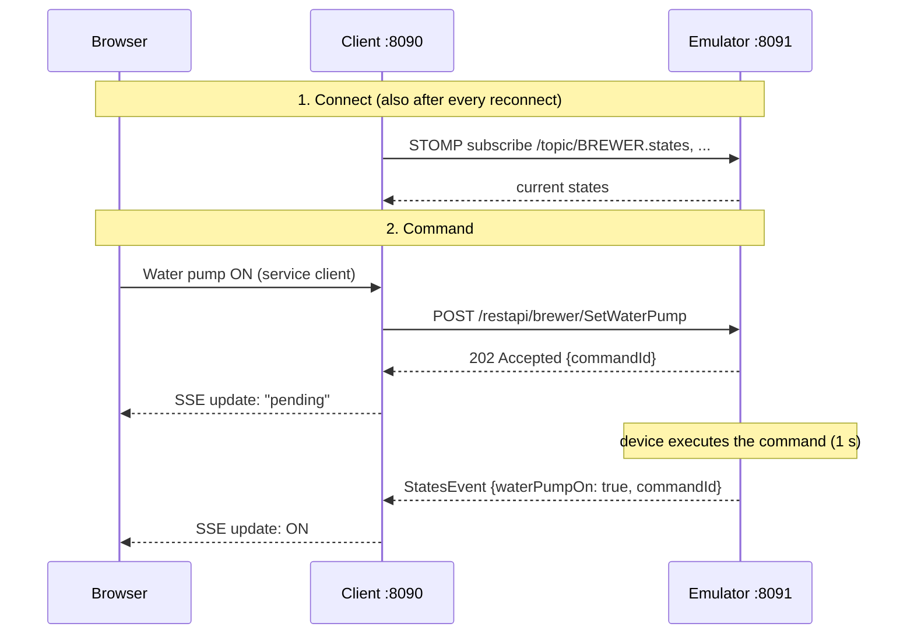

# Mplex Demo App

A small Spring Boot demo of how a control software talks to a device. The communication is a simplified, web-based
remake of the Modaplex software (originally a JavaFX desktop application for a laboratory device). For illustration, the
laboratory subsystems were replaced by a coffee machine: a `HEATER` with water heater and a `BREWER` with water pump.
Instead of real hardware, an emulator plays the device.

## What it shows

- **Commands via REST, results as events:** the client sends a command (eg "water pump on"), the device only confirms it
  (`202 Accepted` + `commandId`). The result follows asynchronously as event with the same `commandId`.
- **Events via STOMP over WebSocket:** state changes and errors of the device reach the client without polling.
- **Live browser update via Server-Sent Events:** the browser pages update themselves as soon as an event arrives.
- **API first:** the REST interface is defined in OpenAPI, client and server code are generated from it.
- **Device rules across subsystems:** invalid commands are rejected with `409 Conflict` as ProblemDetail (RFC 9457),
  eg the pump can't run while the water heater is off. An overheated heater (`OVERHEATED`) switches itself off and with
  it the pump, a jammed pump (`PUMP_JAMMED`) switches off only the pump.
- **Robust connection:** the client reconnects 3 times (after 2, 4, 8 s) and shows the connection state. On every connect and
  reconnect the emulator sends its current states.

## Architecture



If no result event arrives within 5 s, the client shows "no result from device".

## Modules

| Module                | Content                                                                                         |
|-----------------------|-------------------------------------------------------------------------------------------------|
| `device-commands-api` | Commands to the device (REST): OpenAPI specs, generate `client-api` and `server-api`            |
| `device-events-api`   | Events from the device (STOMP): classes like `StatesEvent`, `ErrorEvent` with their destination |
| `emulator`            | Plays the device: executes commands, sends events, web page to trigger errors                   |
| `client`              | Control software: status page, service client with commands (login required)                    |

## Technologies

Java 21, Spring Boot 3.5 (Web MVC, WebSocket/STOMP, Security, Thymeleaf), OpenAPI Generator, springdoc (Swagger UI),
Lombok, Bootstrap 5, Maven, Docker Compose.

## Getting started

```bash
git clone https://github.com/chrisme86/mplex-demo-app.git
cd mplex-demo-app
```

With Docker (no local JDK or Maven needed):

```bash
docker compose up --build        # stop with Ctrl + C
```

Or with JDK 21 and Maven:

```bash
mvn clean install
./start-all.sh        # stop with Ctrl + C
```

| URL                                   | What                                                      |
|---------------------------------------|-----------------------------------------------------------|
| http://localhost:8090                 | Client: current device states (read only)                 |
| http://localhost:8090/service_client  | Service client with commands, login `service` / `service` |
| http://localhost:8091                 | Emulator: device states, trigger errors                   |
| http://localhost:8091/swagger-ui.html | Swagger UI of the device REST API                         |

Things to try:

- Switch the pump on while the heater is off: `409 Conflict` "Water heater is off". So first the heater, then the pump.
- Switch the heater off while the pump runs: `409 Conflict` "Water pump is running".
- Set the heater error `OVERHEATED` in the emulator: the heater switches off and with it the pump (no cold coffee). The
  heater can't be switched on until the error is `NONE`.
- Set `PUMP_JAMMED`: only the pump switches off and is blocked.
- Stop the emulator: the client shows the reconnect attempts, after a restart "Reconnect" brings back the current
  states.
